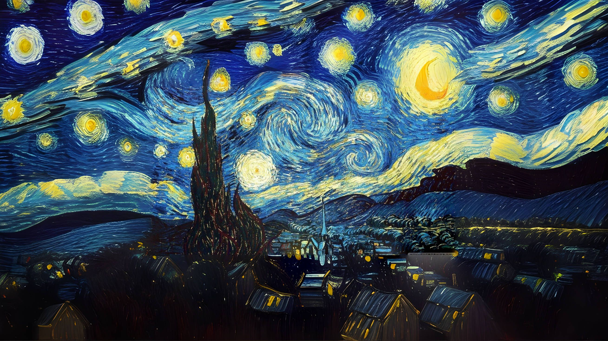

+++
date = '2026-01-20T15:21:12+01:00'
draft = false
title = '''The Anxieties of the Night in Imru al-Qais's poetry'''
+++

I wanted to do a deep dive into one of the prettiest verses in Arabic poetry. This comes from the late-antiquity preislamic poetry of Imru' al-Qais, one of the last poet knights.

Specifically, the verse comes from his hung ode, a poem from a series of seven poems hung on the Kaba in those times as a showcase of the most elegent of late antiquity arabic poems. Think of them like a hall of fame for the best poems from ~600 AD.

The verse itself in Arabic reads as follows:

{}
ولَيْلٍ كَمَوْجِ البَحْرِ أَرْخَى سُدُوْلَهُ \*\* عَلَيَّ بِأَنْوَاعِ الهُمُوْمِ لِيَبْتَلِي
{}

Many a night has let down its curtains around me amid deep grief,

It has whelmed me as a wave of the sea to try me with sorrow.

{}
فَقُلْتُ لَهُ لَمَّا تَمَطَّى بِصُلْبِهِ \*\* وأَرْدَفَ أَعْجَازاً وَنَاءَ بِكَلْكَلِ
{}
Then I said to the night, as slowly his huge bulk passed over me,

As his breast, his loins, his buttocks weighed on me and then passed afar,

{}
ألاَ أَيُّهَا اللَّيْلُ الطَّوِيْلُ ألاَ انْجَلِي \*\* بِصُبْحٍ، وَمَا الإصْبَاحُ منِكَ بِأَمْثَلِ
{}
Oh long night, dawn will come, but will be no brighter without my love.
{}
فَيَا لَكَ مَنْ لَيْلٍ كَأنَّ نُجُومَهُ \*\* بكل مُغار الفتل شُدّت بيذبل
{}
{}
كَأَنَّ الثُرَيّا عُلِّقَت في مَصامِها \*\* بِأَمْرَاسِ كَتَّانٍ إِلَى صُمِّ جَنْدَل ِ
{}
You are a wonder, with stars held up as by ropes of hemp to a solid rock.
