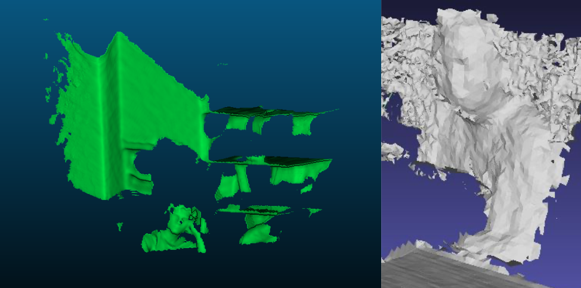
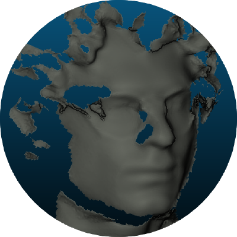
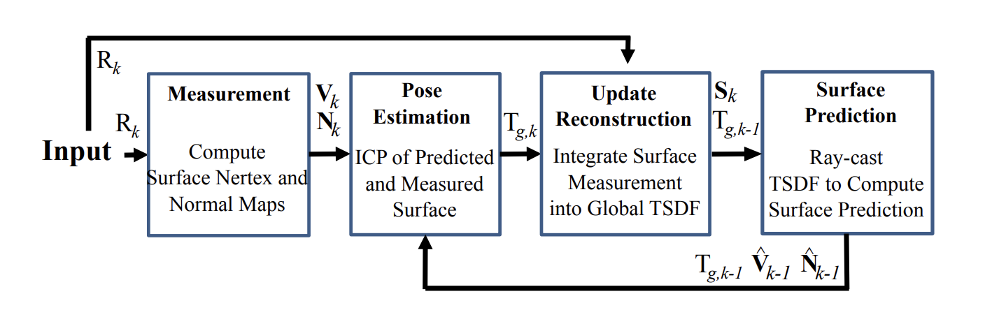
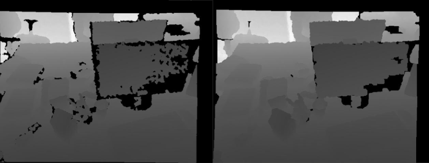
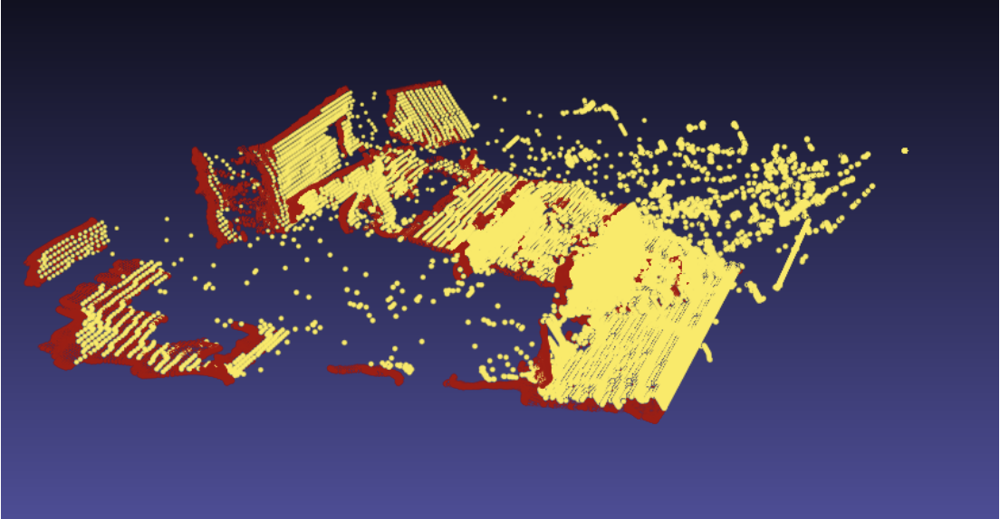
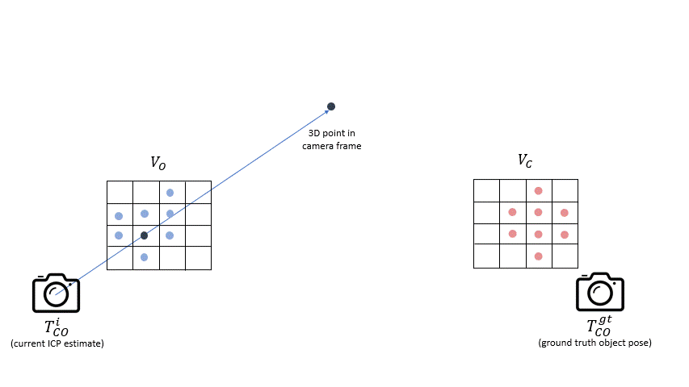
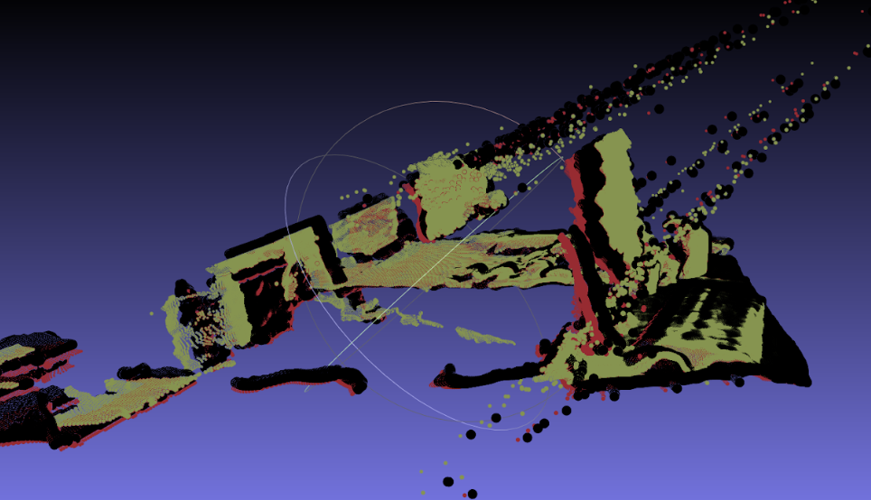
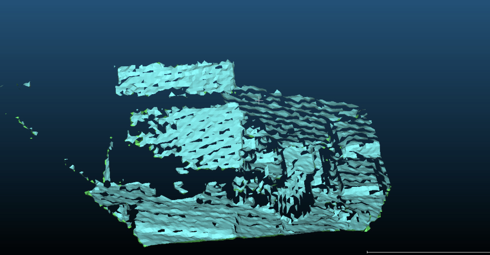

+++
date = '2023-10-19T12:22:14+01:00'
draft = false
title = 'Kinect Fusion'
tags = ["c++", "3D scanning", "cuda"]
+++


[💻 View on GitHub](https://github.com/ScanAround/KinectFusion-Cool-Edition)

## Introduction

This was an implementation of the KinectFusion paper by Newcombe et. al. We parallelized all parts of the project, and so we make use of cuda for each part. The main goal of the paper is to capture and synthesize three-dimensional representations of real-world objects, scenes, or environments from 2D images or point clouds in real-time. We tested our implementation on the TUM RGB-D SLAM dataset.

## Initial Results

## Method

The project consisted of four main componenets as shown in the figure below:

### Surface Measurement

The first step in the surface measurement process is to apply a bilateral filter to the raw depth map to reduce noise, smoothen the image, and fill in holes.

The filtered depth map is then back-projected to a 3D point cloud using the sensor's calibration matrix to generate a vertex map and corresponding vertex validity mask.

Finally, the normal map is created by taking the cross product of two vectors: the vector connecting the pixel with the one above it and the vector connecting the pixel with the one to its right. This preprocessing pipeline is applied to a subsampled depth map pyramid to produce vertices and normals for both 2x and 4x subsampled depth maps.

### Pose Estimation

In our work we aligned measured surfaces with raycasted "predicted" surfaces from the previous frame as shown in the overview figure. This alignment process is iterative and begins with an identity transformation for the first frame. We update our Truncated Signed Distance Function (TSDF) and obtain raycasted predictions in each iteration.

To establish correspondences between the current frame's vertices and normals with those of the previous frame, we employ projective data association, as seen below:

To find correspondences, we transform the current frame's vertices and normals into global coordinates using our iterative transformation. Then, we perform an inverse transformation using the previuos frame's transformation to express these values in the previous camera frame and project them onto the image plane. If a pixel lies within the resolution of the frame, we assign a correspondence to the vertex. This entire process is implemented in CUDA to enhance performance.

Next we used the linearized point to plane algorithm to iteratively determine the transformations from the current frame to the previous frame's vertices, transformed into global coordinates. The problem is formulated as:

$$
(\sum A^TA)x=\sum A^Tb
$$

Here the summands in the matrix A and b correspond to pairs of corresponding points. By calculating the summands and then summing all the matrices in parallel, we achieve higher performance. To optimize memory usage and reduce redundant calculations, we store only the vector corresponding to the column major representation of the lower triangular matrix of A. Vector b is also calculated in parallel.

Finally, the aggregated lower triangular matrix A and vector b are transferred to the host to be solved using the Cholesky solver. To improve robustness, we perform the alignment process over 3 subsamplings of the images at different iteration numbers. Additionally, each current frame is assigned the previous frame's pose before the ICP method is called, with the assumption that its real pose is close to the previous one.

### TSDF

In TSDF (Truncated Signed Distance Function) we represent the surface of an object by assigning a distance value to each voxel in a 3D grid. This distance value represents the distance from the voxel to the nearest surface point. In global fusion, multiple TSDFs from different frames are combined to create a single, more accurate TSDF. This is done by finding the TSDF that is closest to the average of all the other TSDFs. A weight is assigned to each TSDF to reflect its importance. Weighted running average is a simple yet effective method for achieving real-time performance in global fusion. It allows us to easily integrate the TSDFs of multiple frames without sacrificing accuracy. The global TSDF is then converted into a 3D mesh using the marching cubes algorithm. This mesh can be used for visualization or further processing.

### Surface Prediction

The fourth step is to raycast the TSDF from the current estimated camera position. To obtain the surface explicitly, we cast rays from a single position and rays traverse the volume voxel by voxel. Whenever it hits a zero-crossing, we assign that voxel as surface. Then we calculate the vertices and normals of the global scene. This yields a dense surface representation of the TSDF. The raycasted model, together with the normal vectors of the vertices, is fed to the ICP step for alignment with the new frame. During this work, we encountered some problems while implementing two aspects from the original paper: ray skipping and vertex interpolation. Ray skipping could have given us some perfomance boost and vertex interpolation could have yielded more accurate surface predictions, but we could not manage to implement them in the correct manner. Therefore, we decided to traverse the ray using a step size of one voxel, and consider the voxel right after the surface as out point of intersection.
