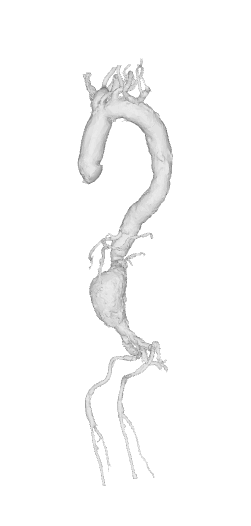
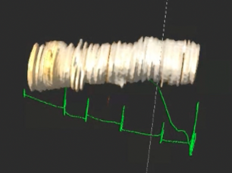
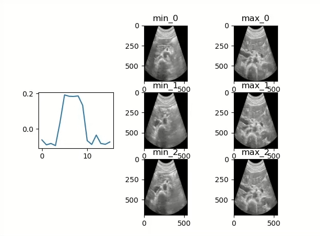
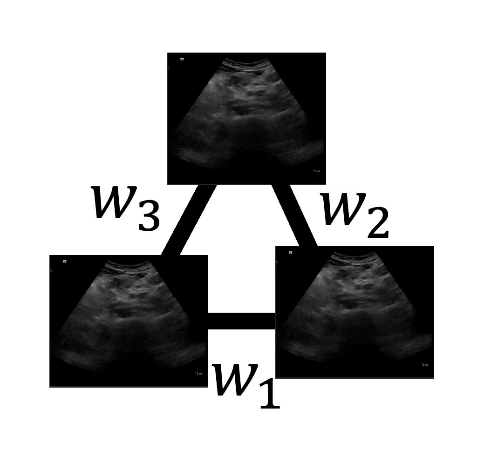

+++
date = '2022-11-01T15:09:37+01:00'
draft = false
title = 'Aorta Robotic Ultrasound'
tags = ["python", "ROS2", "graph learning"]
+++



## Introduction

This project aimed to develop an automated robotic ultrasound system to accurately measure the volume of the aorta, to help diagnose aortic aneurysms using Ultrasound.

Already given is an Ultrasound segmentation model known as CACTUSS. The goal was to compound different slice segmenations along the aorta to create a 3D volume of the whole aorta.
We first try to get the ground truth ultrasound aortas, using a simple button control scheme that captures the aorta only during the exhale phase. We then compare it to more experimental approaches using spectral embedding applied to all breathing phases and compare the volumes.

## Results

Ground truth compounded results of the aorta. The green line below the aorta corresponds to the breathing of the patient

For the spectral embedding we take an ultrasound sequence that contains one inhale and one exhale, and try to measure the breathing purely from the images of the sequence:

## Method

### Button Control Pipeline

<iframe class="iframe" width="600" height="315" src="https://www.youtube.com/embed/5505LbYLCPM?si=V3HCgNqcSvg0uaP2" title="YouTube video player" frameborder="0" allow="accelerometer; autoplay; clipboard-write; encrypted-media; gyroscope; picture-in-picture; web-share" allowfullscreen=""></iframe>

### Spectral Embedding

In spectral embedding we generate graphs from the sequence of images. Consider a graph with nodes and edges 𝐺 ∈ (𝑉, 𝐸) where:

- V corresponds to each image
- E contains weights generated by the heat-kernel equation calculated by summing the square distances:

$$
w_{if}=w_{fi}=\exp({-\frac{||v_i-v_f||^2}{2\sigma^2}})
$$

For example, assuming we take 3 consecutive frames, we get a graph with 3 nodes and 3 weights:

We only connect the L nearest neighbour images in the sequence and thus we're able to create a graph adjacency matrix .
After calulating the Laplacian Matrix of the graph: $$(𝐿=𝐷−𝐴)$$

we can calculate the k smallest Eigenvector of Laplacian Matrix as follows:
$$𝐿𝑓=𝜆𝑓$$

Intuitively what we're doing is reducing the dimensionality of the graph we constructed (in our case to one dimension). This we assume corresponds to the breathing direction of the seqeunce of images, which also reduce the noise of the Ultrasound images.
