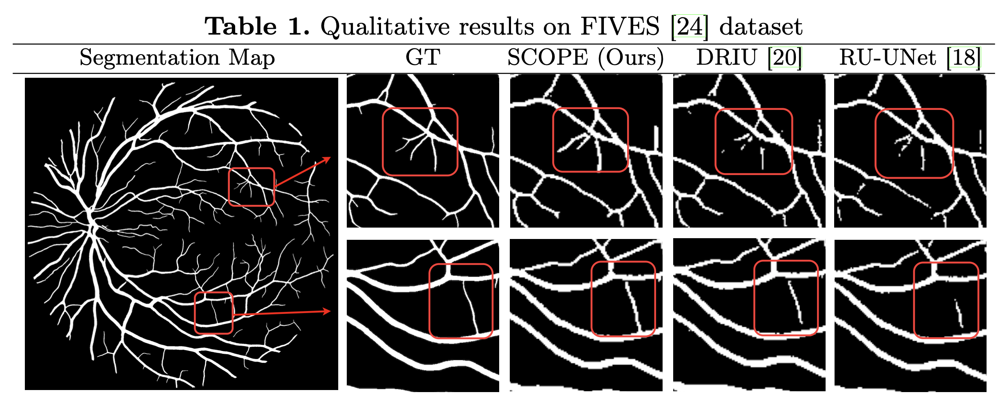

+++
date = '2023-04-28T12:23:29+01:00'
draft = false
title = 'SCOPE'
tags = ["pytorch", "python"]
+++

[🎓 Read the Paper](https://arxiv.org/abs/2304.14572)

## Abstract

Although the preservation of shape continuity and physio- logical anatomy is a natural assumption in the segmentation of medical images, it is often neglected by deep learning methods that mostly aim for the statistical modeling of input data as pixels rather than inter- connected structures. In biological structures, however, organs are not separate entities; for example, in reality, a severed vessel is an indication of an underlying problem, but traditional segmentation models are not designed to strictly enforce the continuity of anatomy, potentially lead- ing to inaccurate medical diagnoses. To address this issue, we propose a graph-based approach that enforces the continuity and connectivity of anatomical topology in medical images. Our method encodes the conti- nuity of shapes as a graph constraint, ensuring that the network’s predictions maintain this continuity. We evaluate our method on two public benchmarks on retinal vessel segmentation, showing significant improvements in connectivity metrics compared to traditional methods while getting better or on-par performance on segmentation metrics.

## Results

## Architectural Overview

We designed our architecture as follows: A visual graph is constructed using patches and 1-level edge connections in (A), node features are generated in (B), graph features are extracted in (C) and combined with initial spatial features using skip connections, and final image segmentation is produced in (D) by extending node predictions into corresponding patches.
